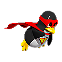

  

<h1 align="center">Nio</h1>

  <strong>One file. A local AI friend, entirely on your own machine.</strong> 
  <em>Simple. Light. And it's a friend.</em>

  
  
  

🐧 <strong>Linux only</strong> (Ubuntu, Mint, Fedora, Arch, …) — no Windows or macOS build.

Nio is your loyal friend. Just click on the Nio.AppImage and chat with him.
His mind, his memory of you, and his voice — **all of him in one file.**
No cloud, no accounts, no server, no separate model to carry.
Nothing about him phones home.

Not a tool, not a pipeline — a companion.
Just download Nio, run it, and start talking.

---

## Why Nio is different

Everything about Nio points at one idea: **the whole friend in one file.**

- **A friend, not a toolbox.** Nio is for *everyone*, not power users. Warm, light, a little playful. He wants to talk, not to be configured.
- **One file, all of him.** No pieces to assemble, no model to fetch, nothing to wire up. One download, one click, done.
- **Nothing leaves your PC.** Your chats, your memory, and Nio himself stay on your machine. No cloud, no accounts, no sign-up.
- **He's his own mind.** No model manager, no hunting for weights. You don't plug a brain into Nio — Nio *is* his own mind.
- **He remembers you.** A small, plain-text memory holds you — your name, where you live, what you like — so he knows you the moment you're back.
- **He's gentle by design.** Nio reads, looks things up, and talks. He doesn't write, edit, delete, or run shell commands. He's a friend, not an admin.

---

## What Nio can do

- 💬 **Chat** — a clean Web UI with streaming text and markdown.
- 🧠 **Remember you** — tell him something about yourself and he keeps it across restarts.
- 🔎 **Look things up** — search the web and read pages, then answer you in his own words.
- 🎙️ **Talk** — dictation, Text-to-Speech, and a continuous **Live** hands-free mode.
- 📄 **Read files** — point him at a file and he'll read it. *(Read-only.)*
- 🎨 **One calm look** — Nio's own marble theme.

---

## Getting Nio (2 minutes)

1. Download Nio.AppImage
2. Click on the Nio.AppImage. Done.

> 🐧 **Nio is for Linux only** (Ubuntu, Mint, Fedora, Arch, etc.). There is no Windows or macOS build.

**You need only:**

- A Linux computer (Ubuntu, Mint, Fedora, Arch, etc.).
- A modern browser — **Microsoft Edge** is recommended (best TTS voices), **Google Chrome** works too. Nio picks one automatically.
- *(Optional)* A GPU with Vulkan support for faster replies. Without one, Nio falls back to your CPU gracefully.

**That's it.** No Node.js, no npm, no pip, no docker.

---

## Talking to Nio

1. Click the **Nio** desktop icon.
2. Your browser opens to `http://127.0.0.1:8791`.
3. Say hello. **Tell Nio your name — he'll remember.**
4. That's it. Talk to your friend.

### The buttons

| Button | What it does |
|---|---|
| ＋ New chat | Start a fresh conversation (Nio keeps just the current one) |
| 🎤 Mic | Toggle voice dictation |
| 🔊 TTS | Toggle Text-to-Speech |
| 🎤 Live | Continuous hands-free voice conversation |
| ⏸ Pause | Stop Nio mid-answer and redirect him |
| **N,NNN ctx** | Click to set how much context Nio keeps in mind (low on a light PC) |
| ❓ Help | Help & shortcuts |
| ⚙️ Settings | TTS voice, speech-recognition language |

### Keyboard

| Keys | Action |
|---|---|
| `Enter` | Send the message |
| `Shift + Enter` | Add a new line |
| `Escape` | Close an open window |

---

## Memory

Nio keeps a small, plain-text memory (`memory.md`) of the basics — your name, where you live, your habits, what you like.

It's a **real file, and it's yours.** You can open it, read it, and edit it any time. Tell Nio *"remember that I live in Athens"* and it's there next time, even after a fresh chat.

---

## Privacy & safety

- **100% local.** Your chats, your memory, and Nio himself never leave your PC.
- **Read-only.** Nio reads files but never writes, edits, or deletes. No shell, no `sudo`.
- **No network.** The server binds to `127.0.0.1` only — nothing about Nio is reachable from outside your machine.
- **No accounts, no telemetry.** There's nothing to sign in to and nothing Nio phones home.

---

## Uninstall

Just delete the Nio.AppImage and the `Nio` folder in your Home folder.

---

## 👤 Made by Tasos Delotas

Nio — one file, one friend, no cloud. Made for the people I used to be.

Licensed under the [MIT License](LICENSE).

---

<small>
<em>
Nio is fully on-device. Under the hood he's built around the
<b>Qwen3.5-2B (Q4_K_M)</b> open-weights model, run by a bundled llama.cpp engine —
no cloud, no external servers. If you'd like the internals:
<code>llama-backend.js</code> drives the bundled <code>llama-server</code>,
<code>agent.js</code> runs the conversation loop and tools,
and <code>web.js</code> is a zero-dependency Node.js server.
Node.js and llama.cpp ship inside the same file.
</em>
</small>

